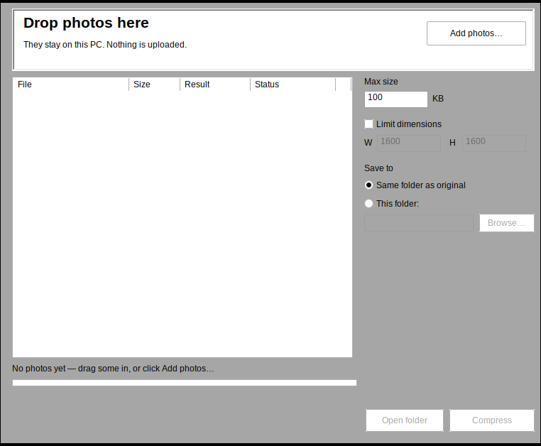

# Kilobyt

**Make a photo provably fit an upload limit. Offline, no account, nothing uploaded.**

Form portals say *"photo must be under 100 KB"* (often with a pixel limit too), your photo isn't,
and every free tool that fixes it wants you to upload an identity document to a stranger's server.

Kilobyt is one small Windows exe. You drop photos in, type the limit the form gives you, and you get
a file that is **at or under that limit** — or no file at all, with an honest message saying what the
smallest achievable size is.



> Screenshot is a real capture of the running binary (under Wine on Linux, so the widget theme is
> plainer than on Windows 11). Windows CI runs the same exe's `-selftest` on every push.

## Download

**[Kilobyt.exe — latest release](https://github.com/nullpointio/kilobyt/releases/latest)**

* Windows 10/11, x64, no installer, no runtime to install — a single native exe of under 600 KB.
* The exe is **unsigned**, so Windows SmartScreen will warn you on first run (`More info → Run anyway`).
  SHA-256 hashes for every release are in `SHA256SUMS.txt` on the release page.
* Windows only. There is no Mac or Linux build.

## What it does

- **Exact byte limit.** You ask for 100 KB; you get a file that is ≤ 100,000 bytes. 1 KB = 1000 bytes
  here, which also satisfies any portal that counts 1024 — it rounds in your favour.
  The size of the written file is re-read from disk before the app says "done".
- **Optional pixel limit.** `600 × 600 max` means exactly that; it shrinks to fit, keeps the aspect
  ratio, and **never upscales** a smaller photo.
- **Batch.** Drop 40 photos, one limit, per-file result. Files that can't reach the limit are named,
  the rest finish; the run is never aborted by one bad file.
- **Honest failure.** If a 20 KB limit is impossible for a 12 MP photo, Kilobyt writes nothing and
  tells you the smallest size that *is* achievable. A file that quietly misses the limit is worse
  than no file, because you'd only find out when the form rejects it.
- **Metadata stripped.** EXIF, GPS coordinates, camera serial, timestamps, XMP, IPTC and comments are
  all removed. Rotation is baked into the pixels, so the photo stays upright without an orientation tag.
- **Deterministic.** Same photo + same settings = byte-identical output.

## What it is not

No cropping or exact `W × H` output (fit-within only, aspect preserved). No PNG/WebP output
(JPEG only). No HEIC/TIFF/WebP/RAW input — convert those first. No PDF tools. No installer, no
auto-update, no shell integration, no settings that persist between runs.

## Common questions

**Why is the exe unsigned?** There is no code-signing certificate. It is a recurring annual cost with an
identity-verification process, and this project has no revenue. SmartScreen will warn on first run —
`More info → Run anyway`, or verify the SHA-256 from the release, or build it yourself.

**Does "under 100 KB" really mean under 100 KB?** Yes, as measured on the written file: ≤ 100,000 bytes,
re-read from disk before the app reports success. 1 KB = 1000 bytes here, which also satisfies portals that
count 1024. It does not guarantee a particular portal accepts the upload — portals add their own rules
(minimum dimensions, aspect ratio, colour profile), which is why there are no presets.

**iPhone photos are HEIC — will it open them?** No. HEIC needs an HEVC decoder that cannot be bundled in an
MIT-licensed binary. Export to JPEG first (`Windows Photos → Save a copy`) or convert the batch, then run
Kilobyt.

**My photo is rotated / portrait.** Rotation is baked into the pixels, so the output stays upright without
an orientation tag being left behind.

**Can it output exactly 600×600?** No. It fits within 600×600 and preserves the aspect ratio, so a 4:3 photo
becomes 600×450. Cropping would be a guess about what to cut.

Longer answers, and a place to ask: [#1 unsigned exe and SmartScreen](https://github.com/nullpointio/kilobyt/issues/1),
[#2 HEIC](https://github.com/nullpointio/kilobyt/issues/2), [#3 the size guarantee](https://github.com/nullpointio/kilobyt/issues/3),
[start here](https://github.com/nullpointio/kilobyt/issues/4).

## Privacy

No network code is present in the binary: no update check, no telemetry, no crash reporting, no
"share". Your photos are read and written locally, and nothing else is touched. The app stores
nothing between runs.

## Build

Native Rust, no runtime, no installer. ~600 KB single exe.

```bash
cargo test --all --release          # engine tests, run on any OS

cargo build --release                # on Windows: target/release/kilobyt.exe
# or cross-compile from Linux with MinGW:
rustup target add x86_64-pc-windows-gnu
cargo build --release --target x86_64-pc-windows-gnu
```

The whole algorithm lives in `src/fit.rs` — a plain library with no UI or Windows dependency, so the
compression search, resampling, EXIF handling and naming are tested on any platform. `src/ui_windows.rs`
is a thin Win32 shell (no GUI framework). CI runs `cargo test` and clippy on Linux, runs the tests plus
`kilobyt.exe -selftest` on `windows-latest`, and publishes the release on a `v*` tag.

The product spec, including the exact algorithm and its acceptance criteria, is in [`docs/prd.md`](docs/prd.md).
The original C#/.NET implementation is kept on the `csharp-v1` branch for reference.

## License

MIT — see [LICENSE](LICENSE).
